# CoilGen2

### Design the field. Shape the surface. Build the winding.

**Open-source magnetostatic coil design for MR gradients, shim coils and custom magnetic fields.**

Create a support surface, define the field you need, optimize its surface current,
and develop the result into a connected winding. Work visually in the desktop or
browser, or automate the same numerical engine from Python.

[Get started](#get-started) · [Feature tour](#feature-tour) · [Examples](#computed-coil-examples) ·
[Python API](#python-and-reproducible-studies) · [Documentation](../docs/README.md)

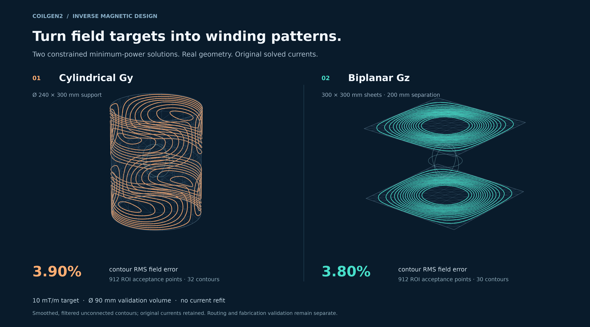

*Two computed examples at their original solved currents. These are smoothed,
filtered contours; routing and fabrication checks are separate stages.
[Configurations, numerical evidence and figure sources](../docs/frontpage/README.md).*


## Get started

**Windows:** run `Setup CoilGen2.cmd`, then open `Start CoilGen2 GUI.cmd` or
`Start CoilGen2 Browser.cmd`. Choose **Browse examples… → Gradients → Cylindrical
Y gradient (Gy)** and click **Compute full design**. Open **Runs → View results**
to inspect the winding, its field and the engineering findings.

<details>
<summary><strong>Terminal installation · Python 3.10+</strong></summary>

```bash
git clone https://github.com/Philipp-MR/Coilgen2.git
cd Coilgen2
python -m venv .venv
```

Activate `.venv` with `.\.venv\Scripts\Activate.ps1` on Windows PowerShell or
`source .venv/bin/activate` on Linux/macOS, then:

```bash
python -m pip install --upgrade pip
python -m pip install -e ".[gui,web,plot]"
python -m coilgen.gui
# Or: python -m coilgen.web
```

For scripts and numerical studies, install `python -m pip install -e ".[research,plot]"`.
Linux Gmsh installations also require the GLU runtime; see the installation guide.

</details>

[Installation guide](../docs/INSTALL.md) · [Desktop guide](../docs/NATIVE_WORKBENCH.md) ·
[Browser guide](../docs/BROWSER_WORKBENCH.md) · [Choose an example](../docs/EXAMPLES.md)

## Feature tour

| Design task | What CoilGen2 provides |
| --- | --- |
| **Create the surface** | CAD primitives, drag/rotate controls, Boolean subtraction, face deletion, meshing, generated support families and STL import. |
| **Define the field** | Analytic expressions, gradients and solid harmonics, imported field maps, configurable regions of interest and external suppression targets. |
| **Optimize the current** | Tikhonov and constrained optimization, sheet-power and magnetic-energy objectives, minimax current density, physical constraints and tolerance studies. |
| **Develop the winding** | Contour extraction, surface-aware smoothing, group/circuit assignment, automatic connections, return paths and direct 3D route editing. |
| **Set the conductor** | Round, rectangular and custom convex profiles, physical dimensions, inner/outer/centered mounting and 3D conductor sweeps. |
| **Evaluate the result** | Field slices, residuals, harmonics, gradient fits, surface current, resistance/inductance estimates and stage-by-stage comparisons. |
| **Review engineering** | Spacing, bend, clearance and sweep checks; independent field sampling; convergence studies; feeds, waveforms and measured-field comparison. |
| **Work with coil systems** | Multiple channels, shared geometry views, per-channel settings and results, primary/shield configurations and explicit circuit organization. |
| **Export and reproduce** | Portable projects, saved run evidence, checkpoints, STL/CAD packages, cylindrical PCB artwork, reports and Python studies. |

### 1 · A workbench for the whole design

Keep the support, target, conductor, optimization and winding settings together
in **Design setup**. Preview changes in 3D, choose how far to compute, and follow
background jobs without losing the model you are editing. Saved results retain
their submitted settings and distinguish completed computation from engineering
acceptance.

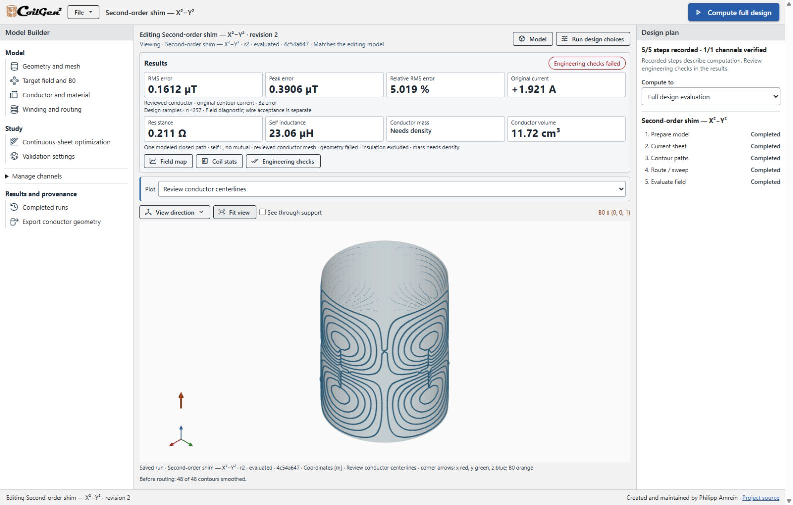

The Qt/VTK desktop and browser share projects and the numerical engine. The
browser also supports separate team workspaces and job queues. Multi-channel
projects keep an explicit editing channel, compute selection and shared view of
the system's supports. [Desktop workflow](../docs/NATIVE_WORKBENCH.md) ·
[Browser and team workspaces](../docs/BROWSER_WORKBENCH.md)

### 2 · Geometry studio: model first, mesh afterwards

Start with colored **cylinders, spheres, boxes or planar sheets**. The object bar
shows each object's dimensions, XYZ position and rotation. Drag along a chosen
axis or enter exact millimetre and degree values. Boolean subtraction keeps its
operands editable, and deleting individual faces creates openings in the final
support.

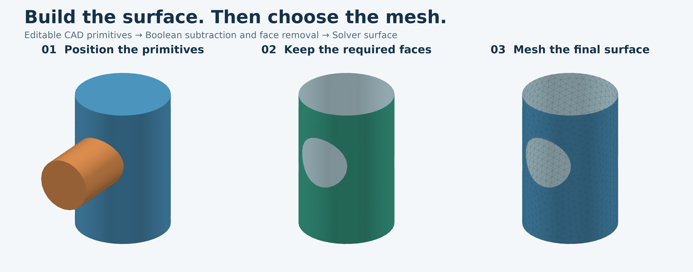

The example uses **two perpendicular cylinders**. Remove the end caps and cutter
faces to retain an open cylindrical wall with a side window. Choose the final
mesh edge length, inspect the triangulation, and apply the support to the active
project. Undo/redo, recipe files and saved projects retain the construction.

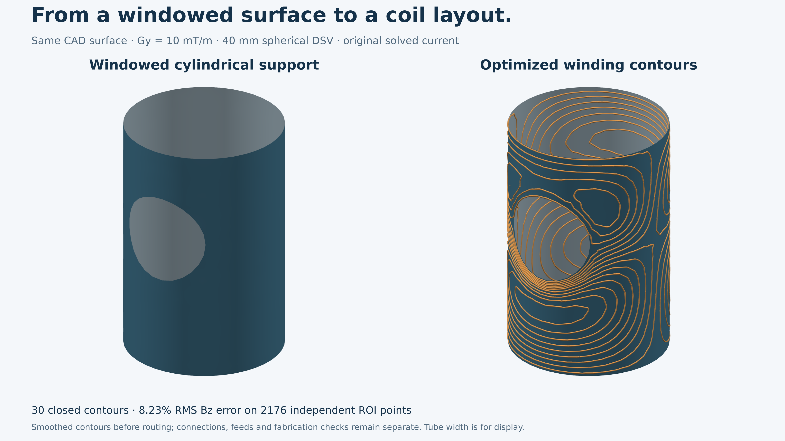

The side-by-side example optimizes a **10 mT/m Y gradient** over a **40 mm
spherical DSV** on this exact windowed surface. It shows smoothed, unconnected
contours at the original solved current; routing, feeds and fabrication review
follow afterwards. [Calculation and field evidence](../docs/images/welcome-windowed-coil-evidence.json) ·
[Reproduce this layout](../docs/frontpage/windowed_coil.py)

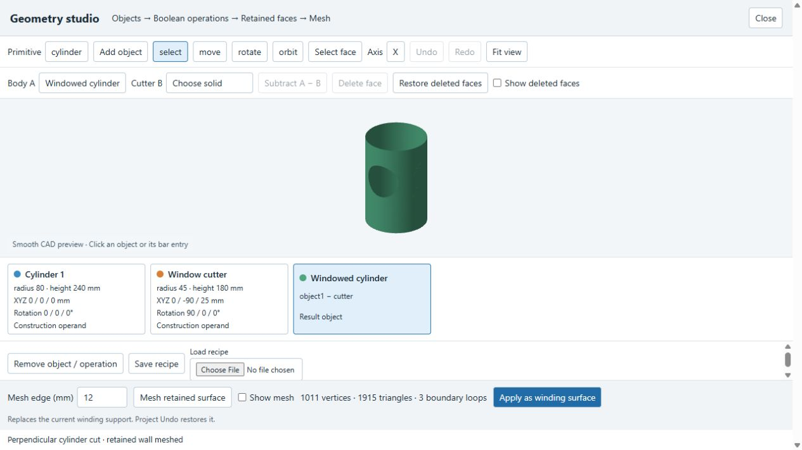

Open **Edit → Geometry studio…** on desktop or **Support geometry → Geometry
studio…** in the browser. [Geometry studio guide](../docs/SURFACE_EDITOR.md)

### 3 · A broad support library

Use generated geometry when a parametric support is sufficient, or import an
STL with explicit units. Geometry parameters, mesh sampling and boundaries stay
part of the saved model.

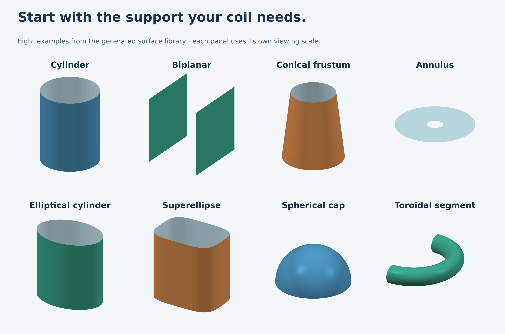

The graphical catalog also includes rectangular and circular planes, partial
cylinders, circular biplanar supports and ellipsoidal caps. Primary/shield
cylinders and an external suppression surface have dedicated controls.
[Primitive geometry reference](../docs/PRIMITIVE_GEOMETRIES.md) ·
[Support and field-region controls](../docs/NATIVE_WORKBENCH.md#support-surfaces-and-field-regions)

### 4 · Targets, shims and active shielding

Specify a Cartesian gradient, a solid-harmonic shim, an analytic field
expression or an imported field map. Set the ROI's size, location and sampling;
choose field-component and normalization conventions explicitly. Useful-field
requirements and external suppression budgets remain separate.

Primary and shield surfaces can be optimized together. Inspect their individual
fields and the net leakage on the external surface. Imported target maps support
NPZ, JSON, CSV and TSV workflows.
[Target and file formats](../docs/FILE_FORMATS.md) ·
[Actively shielded XYZ example](../examples/shielded_xyz_gradient_README.md) ·
[Shielding-field inspection](../docs/BROWSER_WORKBENCH.md#plot-shielding-at-the-magnet-boundary)

### 5 · Optimize a physical surface current

Choose a formulation that matches the engineering objective: weighted
Tikhonov fitting, constrained quadratic optimization, continuous-sheet power,
magnetic energy, or minimax surface current density. Control field-error
budgets, regularization, smoothness and supported physical bounds.

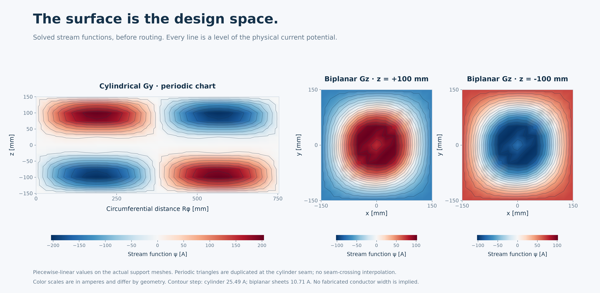

Advanced studies expose symmetry and spectral reductions, finite field
scenarios, force/torque limits in a prescribed background, power/energy caps,
and reusable tolerance sweeps. Custom objective expressions are available
through the physical-design API.
[Optimization guide](../docs/STREAM_FUNCTION_OPTIMIZATION.md) ·
[Physical objectives and constraints](../docs/RESEARCH_PHYSICS_API.md)

### 6 · Contours, circuits and interactive connections

Extract winding contours from the stream function, smooth paths on the support,
and inspect how processing changes the field. **Groups & circuits** assigns
contour groups to circuits, with explicit spiral order and cut-side controls.
Automatic routing then connects the retained turns and returns.

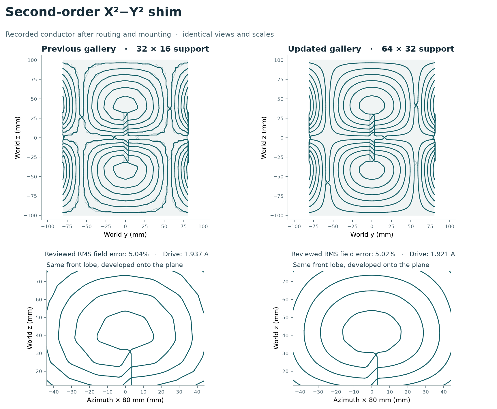

The **interconnection editor** lets you select and drag cuts and guide points,
position plane/sphere/box cutting volumes, preview connections, lock sections,
cut and reconnect paths, and undo individual edits. Group isolation, local
views and winding playback help inspect a crowded route. Save an editable
`.cgwinding` draft and run engineering validation before applying it.
[Groups & circuits](../docs/GROUPS_CIRCUITS.md) ·
[Interconnection editor](../docs/INTERCONNECTION_EDITOR.md)

### 7 · Cross-sections, mounting and swept conductors

Define round or rectangular wire, or edit a custom convex cross-section.
Elliptical and trapezoidal profiles are supported through the profile editor.
Set the conductor's physical size and choose centered, inner or outer mounting
on the winding support.

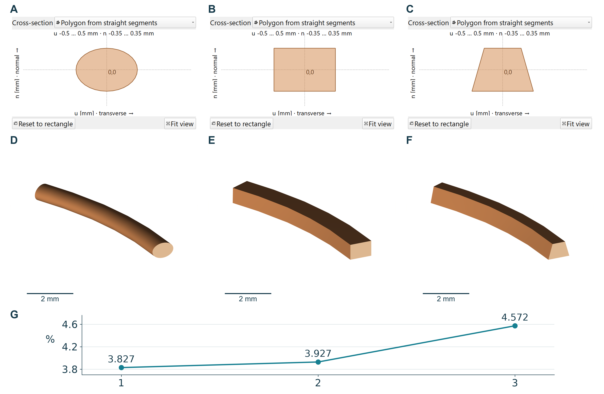

The figure shows actual profile-editor captures and swept geometry. Its field
curve follows one elliptical winding at fixed current through connected,
realized and mounted stages; it is not a field comparison between profile shapes.
The illustrated sweeps failed their configured geometric checks.
[Figure provenance](../docs/frontpage/ismrm2027/README.md#conductor-cross-sections-and-sweeping) ·
[Sweep controls](../docs/PARAMETERS.md#volumetric-sweep-controls)

### 8 · Field analysis at every stage

Compare requested fields with the optimized sheet, extracted contours,
connected winding and mounted conductor centerlines. Inspect slices, residual
maps, RMS and peak errors, harmonic coefficients and gradient fits. Preserve
the current and sampling policy when comparing stages.

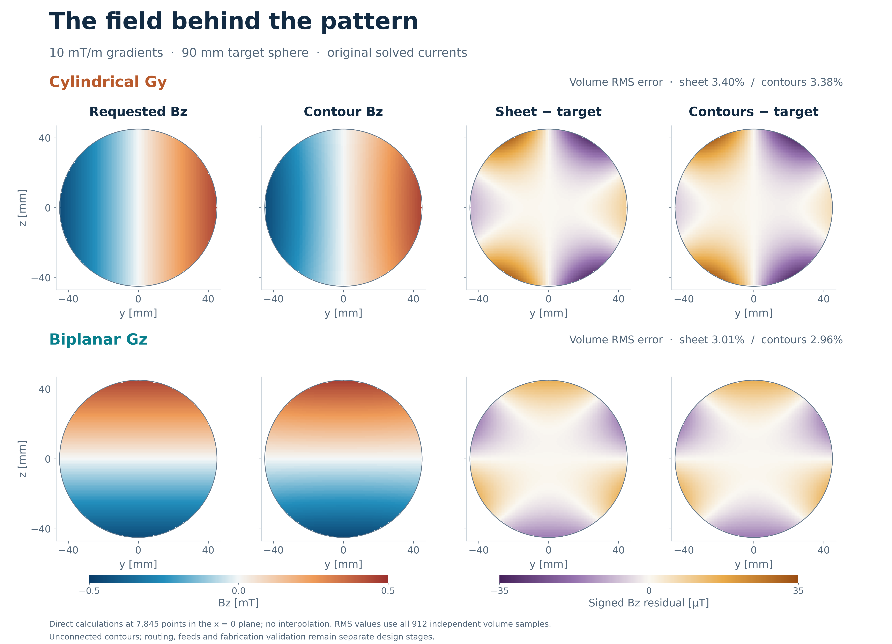

Coil statistics include recorded current, path length, resistance and
inductance estimates where supported, plus conductor mass and volume when
verified geometry is available. Surface current density, wire spacing and
physical copper clearance have distinct diagnostics.
[Result interpretation](../docs/RESULT_INTERPRETATION.md) ·
[Field analysis and coil statistics](../docs/NATIVE_WORKBENCH.md#coil-results-and-field-analysis)

### 9 · Engineering studies, fabrication review and export

Review bends, conductor spacing, support contact, self-intersections and
between-body clearance. Export swept conductor geometry and generate grooved
formers for supported configurations. Cylindrical layouts can also produce
unrolled PCB artwork.

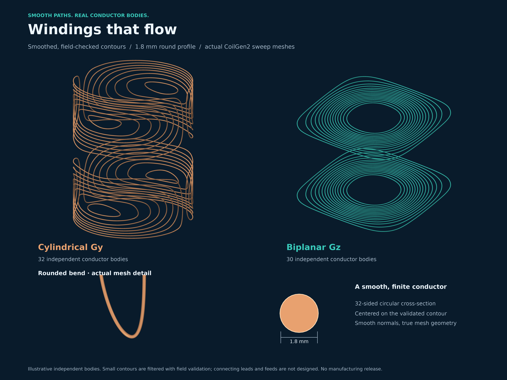

The gradient-engineering tools add mesh/quadrature/sampling convergence studies,
independent winding-field checks, explicit terminals and feed paths,
piecewise-linear drive waveforms, and measured-field comparisons with declared
coordinate transforms and currents. Review the scope of each result before
using it as an engineering constraint.
[Gradient engineering](../docs/NATIVE_WORKBENCH.md#gradient-engineering-workflow) ·
[Exports and saved results](../docs/NATIVE_WORKBENCH.md#ownership-persistence-and-reuse)

## Computed coil examples

Explore shielded cylindrical gradients, biplanar gradients, cylindrical shims
and conical shims. The gallery also provides a starting point for custom support
and field combinations.

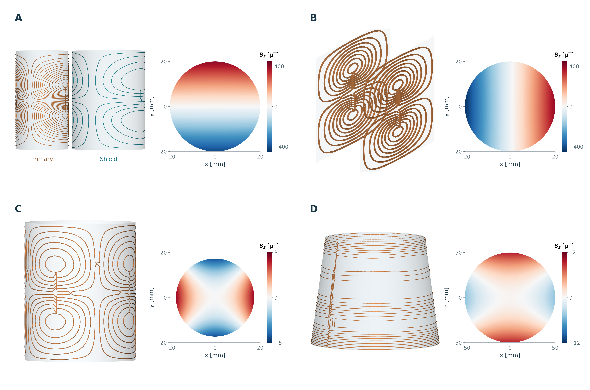

These are the **earlier ISMRM 2027 abstract designs**, evaluated on their mounted
conductor centerlines. They are separate from the current GUI presets.

| Example | ROI radius | Mode efficiency | Relative RMS Bz error |
| --- | ---: | ---: | ---: |
| A · Shielded y-gradient | 20 mm | 1.759 mT/m/A | 4.432% |
| B · Biplanar x-gradient | 20 mm | 1.636 mT/m/A | 11.766% |
| C · Cylindrical X²−Y² shim | 20 mm | 12.635 mT/(m²·A) | 4.572% |
| D · Conical Z2 shim | 50 mm | 2.442 mT/(m²·A) | 10.577% |

Efficiencies are fitted Bz-mode coefficients per ampere at the recorded current.
The shim coefficients multiply `x²−y²` and `z²−(x²+y²)/2`, with coordinates in
metres. [Methods, stage comparisons and provenance](../docs/frontpage/ismrm2027/README.md).

## Python and reproducible studies

The graphical tools use the same engine as scripts. Start from a design class,
use the typed problem API, or control the lower-level configuration directly.

```python
from coilgen import CylinderCoilDesign

design = CylinderCoilDesign(
    target_bz_expression="y",
    target_scale=0.01,             # 10 mT/m
    radius_m=0.12,
    length_m=0.30,
    target_region_radius_m=0.045,
    contour_levels=16,
)
result = design.run()
```

Portable `.coilgen` projects own their inputs and available saved results.
Immutable run records, verified checkpoints and source identities support
resume, comparison and provenance. Research workflows add bounded parallel
jobs, cancellation, tolerance/parameter studies and scoped Pareto selection.
Multi-channel APIs retain shared project parameters and explicit channel overrides.

[Getting started](../docs/GETTING_STARTED.md) · [Object model](../docs/OBJECT_MODEL.md) ·
[Research API](../docs/RESEARCH_PHYSICS_API.md) · [Extension API](../docs/QUALITY_AND_EXTENSION_API.md)

## Model scope

CoilGen2 models magnetostatic surface currents and evaluates discrete winding
fields with thin-filament Biot–Savart calculations. A successful solve, an
attractive rendering and fabrication acceptance are separate outcomes.
Mesh/field convergence and physical qualification remain design-specific.
RF impedance, loading/SAR, transient eddy currents, PNS and structural/acoustic
qualification require additional models and evidence.
[Physical assumptions](../docs/PHYSICAL_ASSUMPTIONS.md) ·
[Diagnostics](../docs/DIAGNOSTICS.md) · [Engineering roadmap](../docs/IMPROVEMENT_ROADMAP.md)

## Documentation and contribution

[All documentation](../docs/README.md) · [Parameters](../docs/PARAMETERS.md) ·
[Examples](../docs/EXAMPLES.md) · [Contributing](../docs/CONTRIBUTING.md) ·
[Report an issue](https://github.com/Philipp-MR/Coilgen2/issues)

The new geometry illustrations are rendered directly from the production CAD
and mesh APIs at 3,840 pixels wide. Existing workbench captures and scientific
figures retain their original image files and numerical scope.
[Reproduce the geometry gallery](../docs/frontpage/welcome_gallery.py) ·
[Geometry evidence](../docs/images/welcome-geometry-evidence.json)

## Citation and license

Created and maintained by **Philipp Amrein**. CoilGen2 continues the original
CoilGen work by Philipp Amrein, Feng Jia, Maxim Zaitsev and Sebastian Littin.
Please cite the original paper and record the CoilGen2 version or commit:

> Amrein P, Jia F, Zaitsev M, Littin S. **CoilGen: Open-source MR coil layout
> generator.** *Magnetic Resonance in Medicine.* 2022;88(3):1465–1479.
> [doi:10.1002/mrm.29294](https://doi.org/10.1002/mrm.29294).

[Citation metadata](../CITATION.cff) · [GPL-3.0 license](../LICENSE) ·
[Contact](../docs/CONTACT.md)
