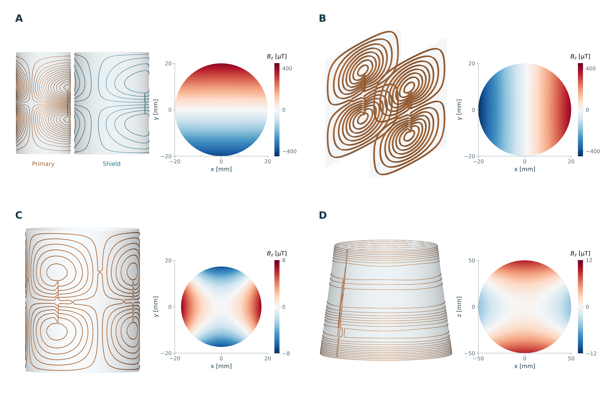
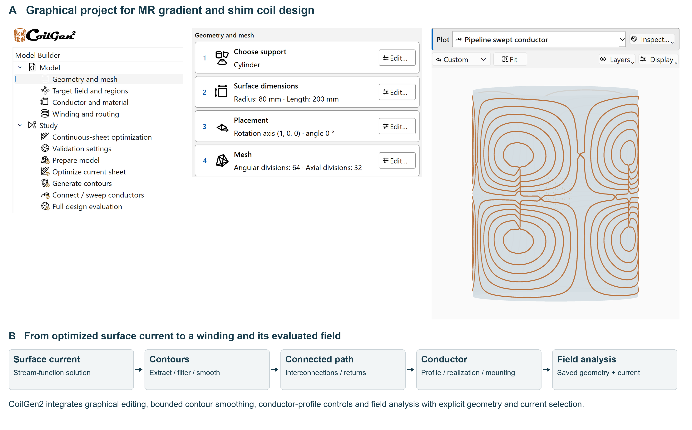

# CoilGen2

**Interactive design and field evaluation for MR gradient and shim coils.**

Define a support surface and target field, optimize the surface current, and
turn its contours into a winding. CoilGen2 brings these steps into a Python
library and a desktop workbench, with field evaluation throughout the process.

[Installation](#installation) ·
[Workbench guide](../docs/NATIVE_WORKBENCH.md) ·
[Examples](../docs/EXAMPLES.md) ·
[Documentation](../docs/README.md)



*Coil designs from the ISMRM 2027 abstract: **A** shielded y-gradient,
**B** biplanar x-gradient, **C** cylindrical X²−Y² shim, **D** conical Z2 shim.
Fields use the mounted conductor centerlines; field scales differ.*

| Example | ROI radius (mm) | Mode efficiency | Relative RMS Bz error (%) |
| --- | ---: | ---: | ---: |
| A · Shielded y-gradient | 20 | 1.759 mT/m/A | 4.432 |
| B · Biplanar x-gradient | 20 | 1.636 mT/m/A | 11.766 |
| C · Cylindrical X²−Y² shim | 20 | 12.635 mT/(m²·A) | 4.572 |
| D · Conical Z2 shim | 50 | 2.442 mT/(m²·A) | 10.577 |

Efficiencies are fitted Bz-mode coefficients of the mounted winding per ampere,
using the same current in each part. The linear examples target **20 mT/m**.
Shim coefficients multiply **x²−y²** (C) and **z²−(x²+y²)/2** (D), with coordinates
in meters; their efficiencies therefore use **mT/(m²·A)**.
[Figure sources and numerical results](../docs/frontpage/ismrm2027/README.md).

## Installation

Requires **Python 3.10+** and Git. In a terminal:

```bash
git clone https://github.com/Philipp-MR/Coilgen2.git
cd Coilgen2
python -m venv .venv
```

Activate the environment:

| Platform | Command |
| --- | --- |
| Windows PowerShell | `.\.venv\Scripts\Activate.ps1` |
| Linux / macOS | `source .venv/bin/activate` |

Install the workbench and scientific dependencies, then launch:

```bash
python -m pip install --upgrade pip
python -m pip install -e ".[gui,plot]"
python -m coilgen.gui
```

Choose **File → Load template** to start with a gradient or shim design.
On Windows, subsequent launches can also use **`Start CoilGen2 GUI.cmd`**.
For scripts without the GUI, install `python -m pip install -e ".[research,plot]"`.
[Full installation guide](../docs/INSTALL.md).

## Design and inspect

- **Optimize:** generated or imported support meshes, analytic or imported
  target fields, suppression regions, regularization and constrained objectives.
- **Build the winding:** extract and smooth contours, connect loops, route
  returns, and set conductor cross-section and placement.
- **Evaluate:** compare sheet, contour and conductor-centerline fields;
  inspect spacing, bend and clearance diagnostics, resistance and inductance estimates.



The workbench and Python scripts share the numerical engine. Saved projects
retain editable geometry, targets and processing settings.

### Check the field after each geometry change

In the abstract's three controlled smoothing examples, 3D RMS curvature fell
**39.8–61.3%** at 0.5 mm arclength sampling. The smoothing-induced RMS Bz change
stayed below **0.010% of target RMS**, with the original signed currents retained.

Later operations mattered more: the biplanar example's relative RMS Bz error
rose from **4.193%** on the connected route to **11.766%** after path realization
and mounting. These comparisons use 2,048 independent volume samples per design,
without gain or offset fitting. [Methods, stage comparisons and provenance](../docs/frontpage/ismrm2027/README.md).

These are numerical examples. Discrete winding fields use thin-filament
Biot–Savart evaluation; the illustrated cylindrical shim conductor fails
configured geometric checks and is not ready for fabrication.
[Physical assumptions](../docs/PHYSICAL_ASSUMPTIONS.md) ·
[Interpreting results](../docs/RESULT_INTERPRETATION.md).

## Python workflow

```python
from coilgen import CylinderCoilDesign

design = CylinderCoilDesign(
    target_bz_expression="y",
    target_scale=0.01,             # 10 mT/m
    radius_m=0.12,
    length_m=0.30,
    target_region_radius_m=0.045,
    contour_levels=16,
)
result = design.run()
```

Geometry uses meters and fields use tesla. This is a starter design;
the abstract figures use separately saved configurations.
See [Getting started](../docs/GETTING_STARTED.md) for plots, reports and exports.

## Citation

Created and maintained by **Philipp Amrein**. CoilGen2 continues the original
CoilGen work by Philipp Amrein, Feng Jia, Maxim Zaitsev and Sebastian Littin.
Please cite the original paper and record the CoilGen2 version or commit:

> Amrein P, Jia F, Zaitsev M, Littin S. **CoilGen: Open-source MR coil layout
> generator.** *Magnetic Resonance in Medicine.* 2022;88(3):1465–1479.
> [doi:10.1002/mrm.29294](https://doi.org/10.1002/mrm.29294).

[Citation metadata](../CITATION.cff) ·
[Contributing](../docs/CONTRIBUTING.md) ·
[Contact](../docs/CONTACT.md) ·
[Report an issue](https://github.com/Philipp-MR/Coilgen2/issues)
