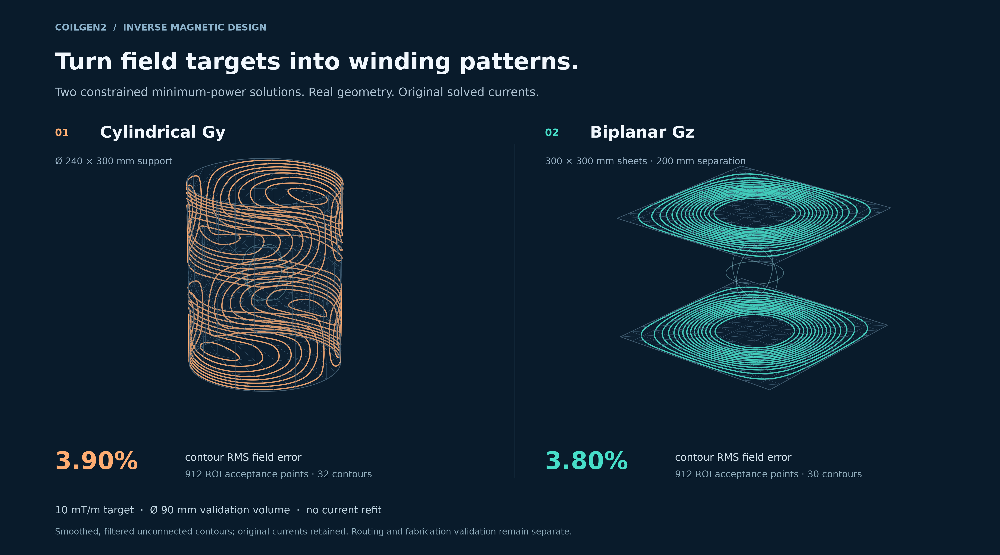

# CoilGen2

**Interactive design and field evaluation for MR gradient and shim coils.**

Define a support surface and target field, optimize the surface current, and
turn its contours into a winding. CoilGen2 brings these steps into a Python
library and a desktop workbench, with field evaluation throughout the process.

[Installation](#installation) ·
[Workbench guide](../docs/NATIVE_WORKBENCH.md) ·
[Examples](../docs/EXAMPLES.md) ·
[Documentation](../docs/README.md)



## Installation

Requires **Python 3.10+** and Git. In a terminal:

```bash
git clone https://github.com/Philipp-MR/Coilgen2.git
cd Coilgen2
python -m venv .venv
```

Activate the environment:

| Platform | Command |
| --- | --- |
| Windows PowerShell | `.\.venv\Scripts\Activate.ps1` |
| Linux / macOS | `source .venv/bin/activate` |

Install the workbench and scientific dependencies, then launch:

```bash
python -m pip install --upgrade pip
python -m pip install -e ".[gui,plot]"
python -m coilgen.gui
```

Choose **File → Load template** to start with a gradient or shim design.
On Windows, subsequent launches can also use **`Start CoilGen2 GUI.cmd`**.
For scripts without the GUI, install `python -m pip install -e ".[research,plot]"`.
[Full installation guide](../docs/INSTALL.md).

## Design and inspect

- **Optimize:** generated or imported support meshes, analytic or imported
  target fields, suppression regions, regularization and constrained objectives.
- **Build the winding:** extract and smooth contours, connect loops, route
  returns, and set conductor cross-section and placement.
- **Evaluate:** compare sheet, contour and conductor-centerline fields;
  inspect spacing, bend and clearance diagnostics, resistance and inductance estimates.

The workbench and Python scripts share the numerical engine. Saved projects
retain editable geometry, targets and processing settings.

### Check the field after each geometry change

Evaluate calculated fields after contour extraction, smoothing, routing and conductor placement. Compare each processing stage against the requested target using the same stated current and evaluation region.

Discrete winding fields use thin-filament Biot–Savart evaluation. Numerical examples do not establish fabricated hardware performance.
[Physical assumptions](../docs/PHYSICAL_ASSUMPTIONS.md) ·
[Interpreting results](../docs/RESULT_INTERPRETATION.md).

## Python workflow

```python
from coilgen import CylinderCoilDesign

design = CylinderCoilDesign(
    target_bz_expression="y",
    target_scale=0.01,             # 10 mT/m
    radius_m=0.12,
    length_m=0.30,
    target_region_radius_m=0.045,
    contour_levels=16,
)
result = design.run()
```

Geometry uses meters and fields use tesla. This is a generated starter design.
See [Getting started](../docs/GETTING_STARTED.md) for plots, reports and exports.

## Citation

Created and maintained by **Philipp Amrein**. CoilGen2 continues the original
CoilGen work by Philipp Amrein, Feng Jia, Maxim Zaitsev and Sebastian Littin.
Please cite the original paper and record the CoilGen2 version or commit:

> Amrein P, Jia F, Zaitsev M, Littin S. **CoilGen: Open-source MR coil layout
> generator.** *Magnetic Resonance in Medicine.* 2022;88(3):1465–1479.
> [doi:10.1002/mrm.29294](https://doi.org/10.1002/mrm.29294).

[Citation metadata](../CITATION.cff) ·
[Contributing](../docs/CONTRIBUTING.md) ·
[Contact](../docs/CONTACT.md) ·
[Report an issue](https://github.com/Philipp-MR/Coilgen2/issues)
