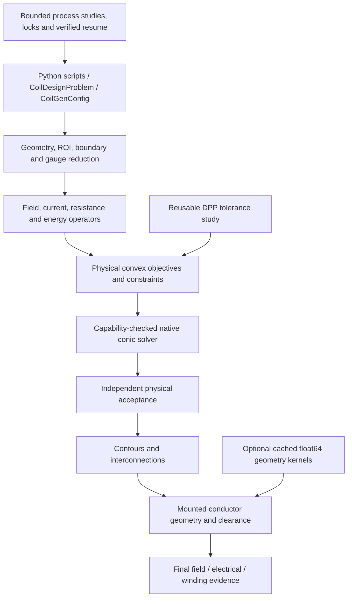

# Main-branch numerical and fabrication integration

The existing main work was committed and pushed first as `3fc94b7`.
This integration ports the non-GUI research functionality into `src/coilgen`;
the independent `CoilGenResearch` repository is preserved and excluded from
main's Git/package/test discovery. No web server, GUI assets or GUI launcher
are included.

## Implemented behavior

| Area | Engineering change |
|---|---|
| Coordinates | Generated ROI translation uses the positive mesh centroid; expressions remain in world coordinates. Independent-grid translation has a regression test. |
| Physical objectives | Sheet power, magnetic energy, maximum vector current density and dimensionally normalized mixtures. |
| Constraints | Existing field/hardware blocks plus custom linear field operators, finite scenarios, force/torque norm limits or equalities, and sheet power/energy caps. |
| Numerical acceptance | Recomputed physical bounds with allowances in each quantity's unit; incompatible/failed solvers do not silently change the problem. |
| Tolerance sweeps | One reusable DPP graph and operator assembly; fixed physical objective references, including full and partial resume. |
| Physical current | Contour, wire and quality evaluation retain the original stream-function current for physical designs; current refitting cannot hide changed power or loads. |
| Energy workload | Explicit convergence/PSD checks and an early face-count guard; no resolution-dependent silent loss of energy evaluation. |
| Material model | Explicit `A_wire/pitch` sheet-thickness homogenization; final conductor resistance/power remain separate. |
| Fabrication geometry | Mounted centroid, cross-section, frames and winding provenance are retained together. Mesh versus analytic surface realization is explicit. |
| Sweep quality | Final mounted bend radius/curvature, mesh collision and all-body clearance checks; strict export gates retain failure evidence. |
| Winding output | Turns/connectors become operations with arclength checkpoints; sampled geometry remains available separately. |
| Runtime | Bounded processes/native threads, cancellation, timeouts, exclusive directory ownership and checksummed restart. |
| Design studies | Failed/cancelled/unknown results remain visible; finite accepted Pareto candidates are separated by physical scope. |

## Architecture



Python remains the API/orchestration layer. Native linear algebra and conic
solvers perform the linear algebra; optional Numba kernels accelerate measured
geometry bottlenecks. Compiled kernel caching is JIT caching, not distributed
AOT binary wheels. No fastmath or parallel floating-point reductions were
introduced in the distance kernels. Same-operator tolerance sweeps reuse the
model; independent geometries can occupy separate processes.

## Run the working examples

From the main repository after activating its environment:

```powershell
python -m pip install -e ".[research,accelerate]"
python examples/research_basic_designs.py
python examples/research_tolerance_study.py
python examples/research_parallel_study.py
python examples/research_valid_fabrication.py
python examples/research_geometry_benchmark.py
```

The first four write evidence below `outputs/`; the benchmark writes
`tmp/research_fabrication/geometry_benchmark.json`. Re-running a study checks
provenance and artifacts before reuse. Changing source, dependencies, inputs or
resolved design settings invalidates reuse.

The basic designs solve to a 4% sampled budget and reserve a 5% final
independent-grid budget. In the integration environment:

| Example | Measured result |
|---|---|
| Cylinder gradient | 4.258% independent relative error; 8.834 W sheet power |
| Biplanar gradient | 3.819% independent relative error; 1.122 W sheet power |
| Balanced tolerance study | 3%, 4%, 6% sampled budgets; fixed reference 8.8336 W and 0.016446 J |
| Circular turn fabrication | 0.0128% error against analytic circular-loop field; 1 winding operation for 128 numerical intervals |

The circular-turn example checks that exported centroid coordinates reproduce
the computed field and saved frames/profile reproduce the swept mesh. It is a
geometrically closed turn with no designed feed break or supply terminals.

A fresh-cache benchmark on Windows/Python 3.12.14, NumPy 2.5.1 and Numba 0.67.0
measured 46.6x/46.5x warm segment/triangle distance speedups. A complete 1,024-face
sweep took 0.784 s with the reference implementation and 0.106 s with the compiled
path (7.37x), with identical mesh arrays and selected diagnostics. Cold compilation
of both kernels took 4.49 s. These are workload-specific measurements, not a
whole-pipeline speed guarantee.

## Compatibility and validation

The physical solver is opt-in through `research_physics`; existing Tikhonov and
constrained-quadratic paths retain their behavior. The legacy surface-realization
default remains analytic. `compile_fabrication` defaults explicitly to mesh
realization. `OptimizationSpec` and `LayoutSpec` bridge the new choices into
the existing typed problem API.

The baseline SCS analytic comparison had an acceptance allowance smaller than
its requested normalized solver accuracy. The fixture now states a realistic
allowance; production acceptance tolerances were not relaxed.

Validation covers analytic energy/self/mutual and loop-field benchmarks,
coordinate/scaling invariants, solver feasibility, fixed-reference graph reuse,
post-mount bend failures, source/realized field differences, compiled/reference
equivalence, process ownership and corrupt-cache rejection. The final
main-environment suite passed **868 tests and 26 subtests** in 70.92 s with
`MPLBACKEND=Agg`; 10 existing Matplotlib deprecation warnings remain. Ruff lint
passes across `src`, `tests`, `examples` and `projects`; formatting passes for
the integration files. Unrelated pre-existing formatting differences were
retained. `pip check` passes and the built wheel contains no GUI files.
The measured benchmark and test log are retained in `validation/main_core/`.

## Deliberate limits

- Dense energy assembly is still quadratic in face count; no FMM, hierarchical
  matrix or GPU energy backend is claimed.
- Positive-genus harmonic circulation bases remain unsupported and rejected.
- Net force/torque constraints do not model local stress, vibration, transient
  eddy currents, RF loading or SAR.
- Mesh facets, tight bends and congested routing can remain infeasible. The
  compiler reports and blocks these cases; a universal automatic router or
  layer/feed planner has not been implemented.
- Sheet caps do not certify final-wire limits. Missing returns or wire-specific
  operators remain unverified. Isolated self-inductance estimates do not replace
  a complete circuit mutual-inductance matrix.

The detailed API and physical conventions are in [RESEARCH_PHYSICS_API.md](RESEARCH_PHYSICS_API.md).
