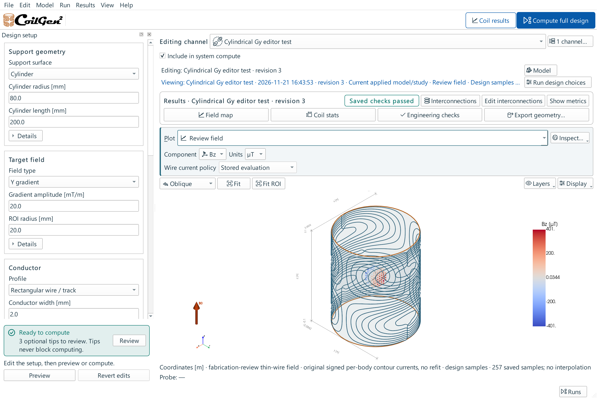
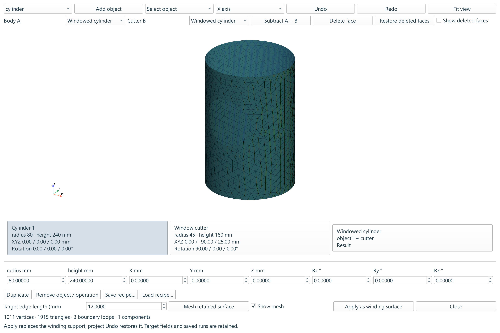
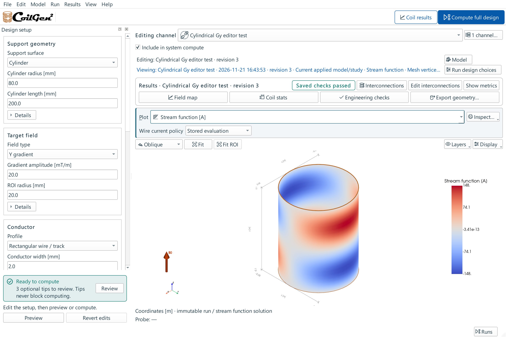
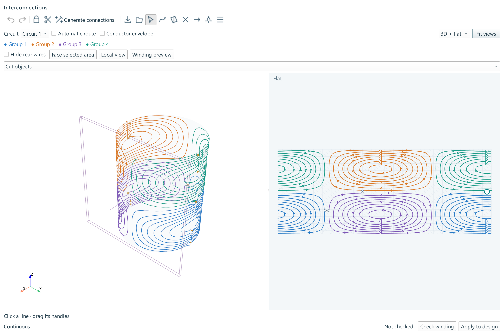
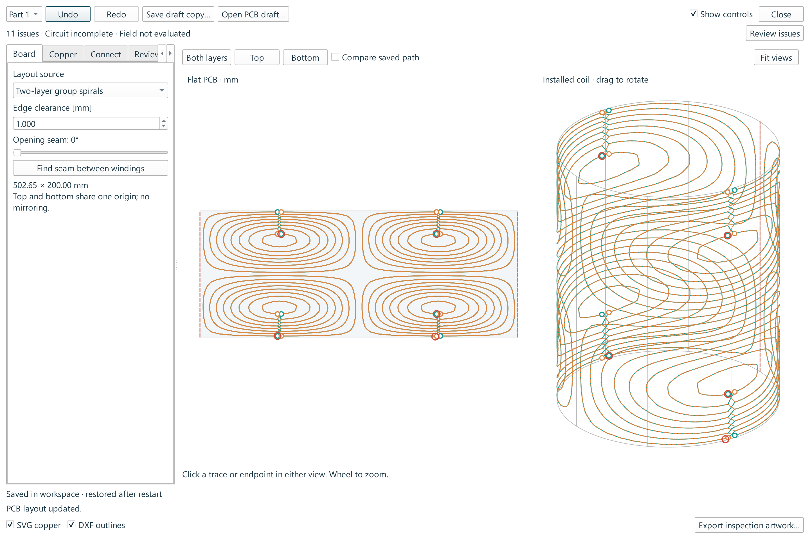
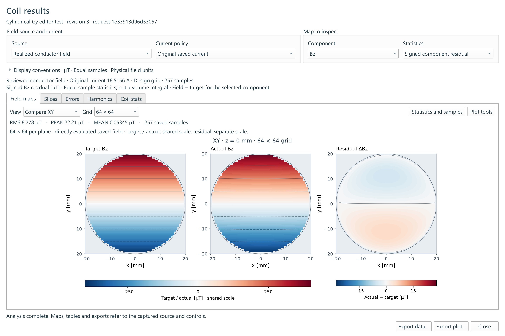
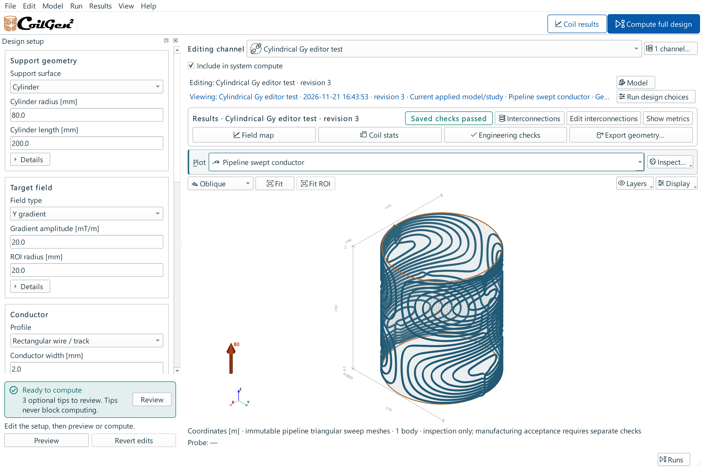

# CoilGen2

CoilGen2 is Python software for designing and evaluating magnetostatic coils.
It computes winding layouts from target magnetic fields and support geometry
and reports field, electrical, and manufacturing diagnostics.

[Get started](docs/INSTALL.md) · [Desktop guide](docs/NATIVE_WORKBENCH.md) ·
[Browser guide](docs/BROWSER_WORKBENCH.md) · [Full desktop image tour](docs/DESKTOP_TOUR.md)

**From a target field to a winding you can inspect.** Set the support, target
region and conductor; solve for the stream function; refine the winding; then
review the field and manufacturing checks. The desktop workbench keeps the
editing model, saved result and current convention visible throughout.

## Explore the desktop

These are high-resolution captures of the native application, with a consistent
white background. Click an image to open it at full resolution.

| Build the support | Inspect the stream function |
| --- | --- |
|  |  |
| Create primitives, subtract openings, select retained faces and mesh the surface. | Inspect the optimized surface current before extracting and routing contours. |

| Shape the winding | Design a PCB or flexible PCB |
| --- | --- |
|  |  |
| Edit seams and connections, inspect groups and preview the winding sequence. | Link flat and wrapped views, review clearances and connectivity, and export SVG/DXF artwork. |

| Evaluate the magnetic field | Inspect the conductor volume |
| --- | --- |
|  |  |
| Compare target and actual field, inspect slices and errors, and fit solid harmonics. | Review the conductor cross section and swept geometry before STL/STEP export. |

The [complete desktop tour](docs/DESKTOP_TOUR.md) also covers target regions,
optimization settings, conductor profiles, smoothing, groups and circuits,
engineering checks, electrical statistics, printable formers, saved design
stages and multichannel active shielding.

The images show computed examples and editable drafts. Source labels, units
and warnings are retained. PCB artwork with unresolved checks is inspection
artwork; it is not a fabrication release. See the [PCB workflow](docs/PCB_LAYOUT.md)
for supported surfaces and export limits.

## Start your first design

On Windows:

1. Run `Setup CoilGen2.cmd`.
2. Open `Start CoilGen2 GUI.cmd` for the desktop, or `Start CoilGen2 Browser.cmd` for the browser.
3. Choose **Browse examples… → Gradients → Cylindrical Y gradient (Gy)** and **Compute full design**.

For manual installation and dependencies, see the [installation guide](docs/INSTALL.md).
The [project documentation](docs/README.md) includes examples, numerical methods
and validation records.

## How to cite

If you use CoilGen2 in a publication, please cite the original CoilGen paper
and report the CoilGen2 release or Git commit used.

Amrein P, Jia F, Zaitsev M, Littin S. **CoilGen: Open-source MR coil layout
generator.** *Magnetic Resonance in Medicine.* 2022;88(3):1465–1479.
[doi:10.1002/mrm.29294](https://doi.org/10.1002/mrm.29294).

Citation metadata is available in [CITATION.cff](CITATION.cff).

## Maintenance and contributions

Maintainer: [Philipp Amrein](https://github.com/Philipp-MR).
See the [contributing guide](docs/CONTRIBUTING.md) for bug reports and contributions.

## License

The CoilGen2 code is licensed under the
[GNU General Public License version 3](LICENSE) (GPL-3.0-only).
Bundled reference code and third-party material retain their existing license terms.
