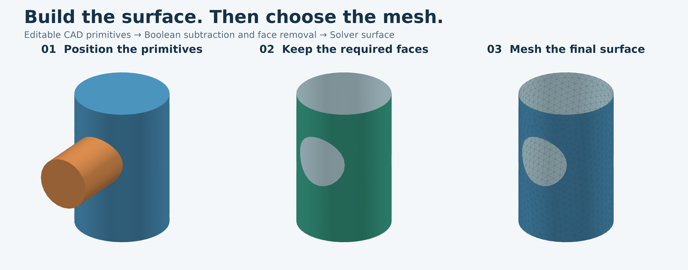

# Geometry studio

Geometry studio creates a winding support from editable CAD primitives. Open it
from **Support geometry → Geometry studio…** in the browser. On the desktop,
use **Edit → Geometry studio…** or the Geometry studio button in the geometry
settings. Apply pending setup edits first.

The editor opens the recipe attached to an existing Geometry studio surface.
For other supports it starts a new cylinder recipe. Applying the finished mesh
replaces the active project's winding support; project Undo restores the prior
support. For channel projects this applies to the active channel.

## Build and edit

1. Add a **cylinder**, **sphere**, **box**, or **plane**. Cylinders, spheres and
   boxes start as closed solids; a plane is a finite rectangular sheet.
2. Select an object in the viewport or its colored entry in the object bar.
   Each entry shows its dimensions, XYZ position and XYZ angles.
3. Choose **Move** or **Rotate**, choose an axis, then drag in the viewport.
   Parameters update during the drag; release to rebuild the CAD result.
   A translucent guide shows the moving primitive. Use the numeric fields for
   exact dimensions or poses, **Orbit** to rotate the camera, and the wheel to
   zoom. **Fit view** frames the current geometry.
4. Choose **Body A** and **Cutter B**, then **Subtract A − B**. The cutter must
   be a closed solid. A sheet can be the body. Operands remain in the object
   bar: edit them to update the Boolean result. Removing a subtraction restores
   its operands; remove dependent operations before removing their inputs.
5. Choose **Select face**, click a face, and **Delete face**. For example, remove
   the cylinder caps to create an open cylindrical support. To make a window
   through its wall, subtract a perpendicular cylinder and remove the new
   cavity faces. Face deletion leaves an opening; it does not heal or fill it.
6. Enter a target **mesh edge length**, choose **Mesh retained surface**, inspect
   **Show mesh**, then **Apply as winding surface**.

Undo/redo restores geometry edits. **Save recipe** and **Load recipe** exchange
`.cgsurface` JSON files. The browser also keeps drafts per project revision and
channel. On the desktop, save the recipe before closing if you want to keep an
unapplied draft. Saved CoilGen projects own both the applied mesh and its CAD
recipe, so reopening does not depend on the original file paths.

The illustrated recipe retains one wall with three boundary loops: the two
open ends and one side window. The cutter stops inside the main cylinder;
extending it through both sides would create a second window.
[Exact recipe and mesh report](images/welcome-geometry-evidence.json).

## Geometry and numerical handoff

- UI lengths are millimetres and angles are degrees. Recipes and solver meshes
  store metres and radians. Rotations apply about fixed X, then Y, then Z axes
  through the primitive centre (`Rz @ Ry @ Rx`), followed by translation.
- OpenCASCADE in Gmsh owns the geometry and Boolean operations. The smooth
  viewport uses disposable triangles for display; these are not the solver
  mesh. Final meshing removes the unwanted CAD faces and triangulates the
  retained surface afresh, preserving shared nodes along CAD edges.
- The requested edge length is a meshing target, not an exact edge-length
  constraint. Check mesh convergence for the field and winding accuracy needed.
- Final meshing checks finite vertices, nondegenerate elements, manifold edges,
  consistent orientation, closed boundary loops and remote triangle
  intersections. It reports triangle quality, area, connected components and
  boundary loops. Separate supports are allowed and use per-part routing;
  intersecting retained supports must be separated or trimmed first.
- Geometry edits invalidate the final mesh. Face deletion references use
  geometric signatures rather than recyclable CAD entity numbers. If an edit
  changes a deleted face, meshing asks you to restore and reselect it. This is
  conservative: even moving an object can require reselecting its deleted faces.
- A project fingerprint and mesh digest prevent applying stale geometry or a
  mesh that no longer matches its recipe. Applying preserves the target and
  optimization settings and uses the existing arbitrary-surface pipeline.

The current limits are 24 construction objects/operations and 200,000 output
triangles. Complex cuts can require a larger mesh edge length. There is no
Boolean union, filleting or arbitrary freeform surface editing in this version.

## Installation and checks

Gmsh is included in the `gui`, `web` and `full` extras. For programmatic geometry
only, install `pip install -e ".[geometry]"`. On Debian/Ubuntu the Gmsh wheel also
needs `libglu1-mesa`. Existing project meshes can load without the CAD dependency;
editing or remeshing their recipes requires it.

Regression coverage includes cylinder area/volume and normals, transformed
sheets, solid and sheet subtraction, face identity, three-boundary windowed
supports, intersection rejection, project round trips, stale edits, concurrent
CAD jobs, browser events and native mouse manipulation. Numerical preparation
checks the generated basis elements and sensitivity matrices on open and closed
CAD supports. These checks do not replace field-convergence or fabrication checks
for a particular design.
