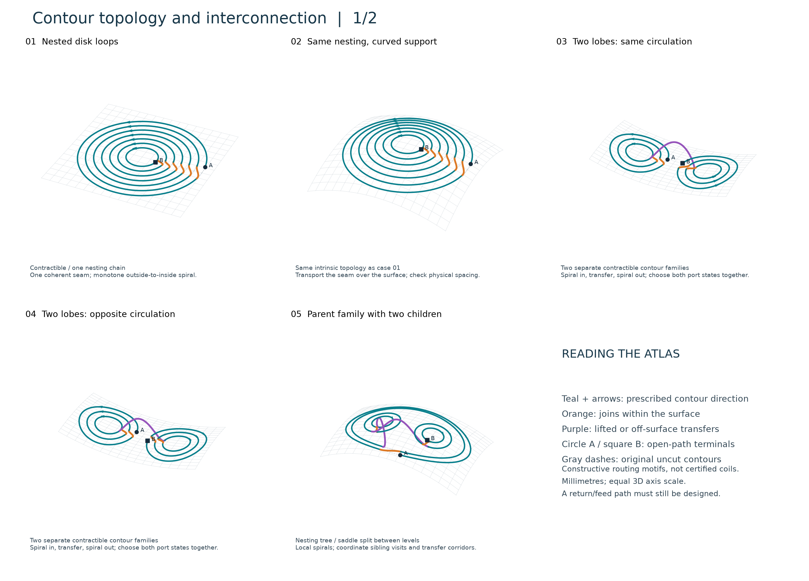
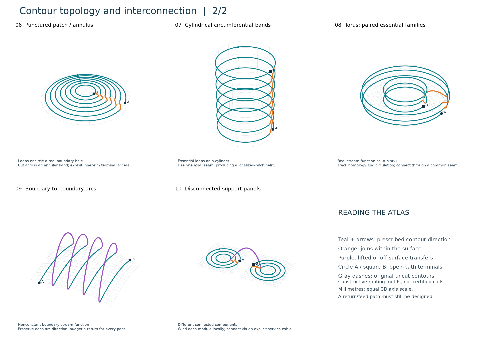

# Contour topology and interconnection study

All study code, generated geometry, figures, and notes live in this folder. No production CoilGen code is imported or changed. The support dimensions are in **millimetres**. This is a theoretical and geometric study, not a field-optimized coil design.

## User priorities — 22 September 2026

**First minimize jumps; then minimize B0 distortion with straight returns along B0.** One continuous raised transfer counts as one jump, regardless of the number of turns it crosses. Ordinary surface joins do not count as jumps. These priorities supersede generic preferences for shortest connection length. See [the agreed definition, proposed objective, and physical implications](DESIGN_PRIORITIES.md).

**Current boundary condition:** one continuous closed conductor, with no prescribed terminals or wire opening. The closing interconnection is optimized together with every other connection. Follow the [revised closed-loop rationale](CLOSED_LOOP_RATIONALE.md); the earlier terminal-based illustrations retain their original, now superseded boundary condition.

The existing atlas and benchmark have not been re-optimized under these priorities. Their return paths and B0 field effects still need the complete-route comparison described in that note.

## Main findings

1. **Topology, current direction, and connection access must be considered together.** Containment geometry alone does not determine a valid connection. The same nested loops can require different routing when their circulation changes.
2. **A coherent seam with adjacent-turn progression is a strong default for a simple contour family.** In the bounded seven-loop experiment it was the only crossing-free order and the shortest connector arrangement among all 120 tested orders.
3. **Design the return and closure as part of the circuit.** An attractive open spiral leaves an inner connection port that must be reconnected. A radial return cannot simply cross the turns on the same layer.
4. **Interconnect groups through directed port states.** Choose inward/outward traversal, cuts, group order, and complete transfer routes together. Inward versus outward traversal does not reverse the circulation around any turn.
5. **A branching contour-family graph is not a branched electrical wire.** Handles and holes add homology constraints; disconnected supports force off-surface leads or separate circuits.

## Read and inspect

- [Twelve illustrated interconnection checks](decision_walkthrough/README.md): a numbered walkthrough of the decision sequence, with three overview sheets and twelve individual schematics.
- [Theoretical classification and engineering interpretation](THEORY.md): ten representative motifs, mathematical restrictions, and primary references.
- [Seven-loop enumeration](BENCHMARK.md): assumptions, reproducible numbers, and limits of the optimality claim.
- [Atlas, cases 1–5](figures/atlas_1.png) and [cases 6–10](figures/atlas_2.png): 3D diagrams with directed turns, surface joins, raised transfers, and explicit terminals.
- [Orderly versus scrambled routing](figures/nesting_comparison.png): the numerical benchmark in a 3D view of its planar support.
- [Four local splice orientation cases](figures/splice_orientation.png): closed two-bridge constructions, with incompatible crossings marked.
- `contour-atlas.html`: interactive visualization fragment used in the conversation. Change case, rotate the view, switch to original contours, or trace the winding sequence. `atlas-preview.html` is its standalone preview.





## Quantitative result and its scope

The seven planar source loops have radii 12, 18, 24, 30, 36, 42, and 48 mm. Their circulation, cuts, outer start, and inner finish are fixed. Only the five interior visit positions vary; 5! = 120 orders are enumerated. All candidates use the same tangent-matched cubic connector rule.

| Quantity | Adjacent-turn order | Example scrambled order |
|---|---:|---:|
| Connector length | 70.755426 mm | 135.601851 mm |
| Connector–connector intersections | 0 | 14 |
| Connector–retained-contour intersections | 0 | 0 |
| Radial progression reversals | 0 | 4 |

The scrambled connectors are 91.65% longer. This is a **connector-only** comparison: both orders retain the same 1252.268915 mm of contour arcs. The reported optimum is restricted to this enumerated order/curve family. Curve lengths use Gaussian quadrature; intersection checks use sampled polylines. It is not a theorem about arbitrary connectors, freely movable cuts, complete closed circuits, or manufactured conductors.

## What the 3D atlas demonstrates

The atlas distinguishes geometric examples rather than pretending all ten are different homeomorphism classes. A flat patch and a dome have the same intrinsic topology; an annulus and an open cylinder are also topologically equivalent. Their physical winding access differs.

Cases 1–7 and 10 use prescribed synthetic contour families and directed arcs. Their arrows are constraints of the examples; no stream-function optimization has been run. Regular scalar functions can realize these finite, disjoint loop patterns with suitable extrema and saddles, but the examples do not prescribe a common equal-current normalization across cases. Cases 1 and 2 can be generated by a monotone radial scalar away from the origin, smoothly continued inside the innermost contour. Case 9 represents equal-direction boundary-fed arcs, not an insulating-edge coil.

Case 8 is explicit: for a torus parameterized by

`X(u,v) = ((37 + 14 cos(v)) cos(u), (37 + 14 cos(v)) sin(u), 14 sin(v))`,

use `psi = sin(v)` with levels `-0.5, 0, +0.5`. With the outward normal and `K = n × grad_S(psi)`, increasing-u circulation has sign `-sign(cos(v))`. Each level therefore contains opposite essential homology contributions. The ordered original source arrays preserve those directions.

Orange joins are mapped into the analytic support. Purple transfers include an explicitly raised service path or leave disconnected supports. They are **candidate routes**, not certified sufficient clearances or globally optimal transfers. Their curve shapes are illustrative; in particular the parent/child and boundary-arc transfers remain engineering design variables. All atlas routes are open A-to-B chains. Neither the supply nor a complete return circuit is hidden in the pictures.

## Validation performed

- All ten atlas cases contain finite coordinates and consecutive pieces meet within 1e-9 mm before display rounding; see [validation.json](validation.json).
- Source orientation was checked against directed retained arcs, including opposite-circulation lobes and the explicit torus stream function.
- The benchmark enumerates every allowed order and repeats its intersection checks after doubling sampling resolution.
- Static figures were visually inspected. The interactive atlas was checked in a browser for case switching, winding progression, and narrow-screen readability.

Still required for a physical coil: complete return/feed geometry; conductor-envelope spacing; bend radius and section twist; support and tooling access; field error at the same current; resistance/inductance; and winding process constraints. C0 continuity and a crossing-free centerline alone do not establish manufacturability.

For a corridor carrying `k` tracks of width `w` with edge-to-edge clearance `g`, reserve at least `k*w + (k-1)*g`, plus edge margins. A paired corridor contains two insulated tracks; it is not a conducting bus or an electrical branch.

## Reproduce

From the CoilGen2 directory, using its existing environment without modifying it:

```powershell
.\.venv\Scripts\python.exe topology_study\generate_study.py
.\.venv\Scripts\python.exe topology_study\benchmark.py
.\.venv\Scripts\python.exe topology_study\plot_benchmark.py
.\.venv\Scripts\python.exe topology_study\build_viewer.py
```

The first and third scripts use NumPy and Matplotlib. The benchmark uses NumPy; the visualization builder uses the standard library. The environment used for this study has NumPy 2.5.1 and Matplotlib 3.11.1. All inputs are analytic and deterministic; no random seed, main-project output, or downloaded data is needed.

The standalone preview can be regenerated with the installed visualization skill's `scripts/render.py`, taking `contour-atlas.html` as input and `atlas-preview.html` as output. This wrapper is a preview convenience; the numeric study and PNG/SVG figures have no dependence on that skill.
