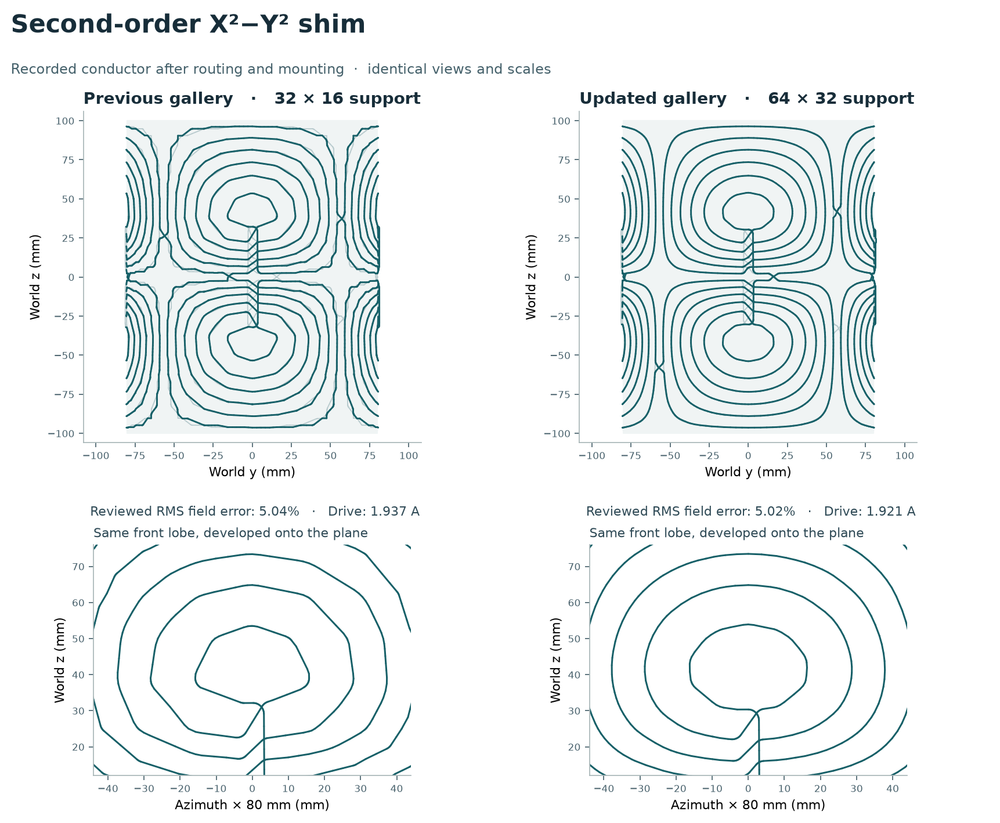

# Winding layout review: GUI examples

The X²−Y² winding in the original screenshot was only partly smoothed. The saved request enabled smoothing, but on its **32 × 16** cylinder only **24 of 48** contours accepted a fit. Eight exceeded the 0.5 mm displacement limit; sixteen were retained for spacing. The native window was showing the mounted wire at about 2.6× whole-coil zoom. A duplicate overlay could darken the line, but the corners themselves were present in the stored geometry.



| X²−Y² measurement | Run shown in the screenshot | Updated GUI template |
|---|---:|---:|
| Cylinder mesh, azimuth × axial | 32 × 16 | 64 × 32 |
| Smoothed loops / extracted loops | 24 / 48 | 48 / 48 |
| Largest applied displacement | 0.482 mm | 0.415 mm |
| Contour P95 turning angle, sampled every 3 mm | 25.19° | 11.23° |
| **Mounted conductor** P95 turning angle, sampled every 3 mm | **27.99°** | **19.81°** |
| Mounted conductor original-current RMS Bz error, design DSV | 5.041% | 5.019% |
| Original contour current used for this field | 1.937 A | 1.921 A |
| Minimum reviewed bend radius (3 mm required) | 1.690 mm | 2.724 mm |

Both runs are full evaluations of the 200 mm long, 80 mm radius insert. Both passed the continuous-sheet check. The new winding **still fails** the final bend, clearance, self-intersection and frame checks. The P95 angle describes typical changes in tangent direction at a fixed physical scale; it cannot certify the tightest bend or rule out a conductor crossing. The field comparison uses each run’s own original stream-function current on the design samples, without refitting the wire current. The standard run applies its independent-grid acceptance check to the continuous sheet.

We separately verified the mounted-wire field on **3,104 held-out points**. For the screenshot run and updated example, the RMS errors were **4.656% and 4.634%**. Before using those points, the calculation reproduced all three components of all 257 saved design-sample vectors exactly at their recorded signed currents. Eight overlapping points were excluded. These are [additional wire-field measurements](verified_wire_holdout.csv); they do not change the run’s verdict.

The failures concern different parts of the wire. The 2.724 mm reviewed bend is on a contour-owned segment (loop 24). A group join and raised return elsewhere are only **0.838 mm** apart against a required **1.664 mm** centerline clearance. Increasing contour smoothing alone cannot fix that crossing. The pipeline sweep and the mounted review use separate realized paths and report separate bend minima.

Two complete routing trials held the fitted contours and the 1.921 A drive fixed. Raising the return eliminated the final capsule-clearance and self-intersection flags, but tightened the worst bend. A wider cut made the typical tangent change smaller, yet introduced a folded sweep and surface penetration. We kept the 6 mm opening and 1 mm lift; none of the three qualified for fabrication. [Recorded routing trials](x2y2-routing-trials.json).

| X²−Y² opening / return lift | Mounted RMS | Mounted P95 turn at 3 mm | Minimum reviewed bend |
|---|---:|---:|---:|
| 6 mm / 1 mm (selected) | 5.019% | 19.81° | 2.724 mm |
| 6 mm / 2.5 mm | 5.044% | 20.28° | 2.084 mm |
| 9 mm / 1 mm | 5.157% | 16.24° | 0.136 mm |

**Open the example.** Restart the updated desktop GUI, choose **File → Load template → Shim coils → Second-order shim — X²−Y²**, then **Compute full design → Jobs → View results**. On the reviewed workstation, **File → Open project…** can open `outputs/gui_winding_quality_2026-11-03/X2Y2 improved winding.coilgen` without recomputing. This generated 169 MB project stays local. A fresh checkout can reproduce it using the commands below. Opening an old project restores its own mesh, fit settings and saved wire. Loading a fresh template does not modify that project.

**Inspect the result.** Choose **Contours before routing** to see the saved loops, or **Review conductor centerlines** for the physical wire including connectors and mounting. **Run design choices** in either workbench shows the actual request and outcomes per support. [Desktop result](native-x2y2-result.png) · [Recorded design choices](native-x2y2-result-choices.png) · [Detailed before/after measurements](x2y2-review.json).

The [small input-only project](X2Y2-inputs.coilgen) contains the exact submitted model and study; open it and compute a full evaluation to generate the winding locally.

The [hidden-browser repeat](browser-repeat.json) computed the template independently after the historical-checkpoint compatibility update. The numerical source digests differ; the two verified jobs have **bit-identical 6,109 × 3 mounted coordinates**, identical fit counts, DSV RMS and bend minimum. A second hidden browser reopened the portable file, displayed its [reviewed conductor and verdicts](browser-x2y2-result.png) and [original request](browser-x2y2-reader.png), and switched between the fitted contours and final wire. All nineteen template entries were opened in the browser; only the two coil systems showed a batch compute action.

## What changed in the examples

New gallery models use surface B-splines with mesh gain 0.1, a 0.5 mm displacement cap and spacing protection. If a whole-loop fit is rejected, the new gallery policy can round eligible corners locally, on the triangulated support, subject to the same displacement, topology and spacing checks. If the candidate fails, the extracted loop is retained. Local fits are a subset of accepted fits. The updated X²−Y² mesh accepted all 48 whole-loop fits without using that fallback. Blank designs, scripts and previously saved projects keep their chosen settings.

Increasing resolution changes the sheet solve and sometimes the actual winding topology. On the biplanar-system X²−Y² channel, **24 × 24** lost twelve loops and raised contour RMS to 18.36%. **20 × 20** kept all 72 and had a better contour-field result, but produced a uniform Bz offset after connecting the wire: mounted RMS rose from **13.24% to 16.49%**. The selected **14 × 14** with guarded local fitting kept all 72, reduced the typical *and* worst measured turns on both plates, and brought mounted RMS down to **10.88%**. The [mesh comparisons](MESH_SELECTION.md) and [local bend and return witnesses](routing-notes.md) explain choices for the other shapes. No conductor, drive-current, bend or clearance limit was relaxed to make a drawing look better.

The conical Z2 template now uses a **64 × 24** support. Five refined meshes reproduced the same family of 35 loops; the coarse support had 37. On the refined template all 35 accepted a bounded fit, compared with 16 of 37 on the guarded coarse candidate. Mounted RMS improved from 20.73% to 5.46% and held-out RMS from 19.10% to 5.31%. Its minimum bend worsened from 1.145 mm to 0.273 mm against a 3 mm requirement. Both candidates failed route and clearance checks. The tighter bend is on a lobe near the end of the cone.

The standalone cylindrical Z2 keeps its **32 × 16** mesh: all 32 rings already accepted a global fit. A 48 × 16 trial reduced typical turning but raised mounted-wire RMS from 32.24% to 33.63% and the worst sampled turn from 90° to 149°. A 64 × 20 trial introduced a near-reversal and a folded sweep. The large RMS is predominantly a uniform Bz offset introduced by discretizing and connecting the rings; it is included in the reported error.

## All nineteen GUI examples

The [channel-by-channel results](case-results.md) compare every final mounted wire against the previous gallery. Across the 29 channels, **1,044 of 1,049** extracted contours accepted a bounded fit, including **262** local fits. The other **five** retained their original geometry to protect spacing. The mounted 3 mm P95 turn decreased in **28** channels. Cylindrical Z2 changed by less than 0.01°. All **42 closed bodies** were retained. Their **178,593** stored vertices match the full scientific results exactly.

| Open a winding gallery | What it contains |
|---|---|
| [Gradient windings](windings-gradients.png) | Conventional cylinders, rotated Halbach cylinders, standalone plates and the shielded Gy. |
| [Shim windings](windings-shims.png) | Six cylindrical shim modes and conical Z2. |
| [Two coil systems](windings-systems.png) | All three cylindrical gradient channels and all nine biplanar gradient/shim channels. |

All 29 sheet checks passed. Every channel failed the pipeline sweep and strict fabrication review. None records a construction release. A few local bend radii worsened even when the typical winding became smoother. In particular, the biplanar-system Z2 and X²−Y² remain visibly faceted on their selected 14 × 14 supports. Finer alternatives either changed the turn family or materially worsened the field of the connected wire. The [routing notes](routing-notes.md) locate measured problems on the actual bodies; the [alternative-study receipts](candidate_evidence.zip) preserve the settings and verdicts.

In the internal browser, each [selected full run](browser-gallery.json) was opened, switched from **Review conductor centerlines** to **Contours before routing** and back, and inspected in the submitted-design reader. The reader exposed per-support fits and the full submitted request. The visible counts, original-current DSV RMS and all three verdicts were matched to the exact archive IDs. The [loading-state capture](browser-loading-run.png) and [first-use review](../gui_review_2026-11-03/GUI_REVIEW.md) show the browser layout used in that campaign. The [browser guide](../../docs/BROWSER_WORKBENCH.md) follows the current controls.

On the reviewed workstation, the 29 finished runs can be inspected without recomputing while the private temporary workspace is retained. Start the standard browser entry point from the CoilGen environment:

```powershell
python -m coilgen.web --data-root "$env:LOCALAPPDATA\Temp\coilgen-winding-quality-20261103\gallery-browser" --port 8970
```

On the browser welcome screen, choose **Open project…**, select a `qa-…coilgen` file under **Saved in this workspace** and click **Reopen saved project**. Its source revision selects the matching result. The workspace history also contains comparison trials. The selected project's history filter keeps them separate.

## Evidence and reproduction

The [previous review](../gui_review_2026-11-03/GUI_REVIEW.md) retains its own settings, images and reported values. The X²−Y² figure above uses the exact screenshot run; the gallery-wide comparisons use the matching published baseline for every channel. They are separate saved jobs. Neither comparison interpolates the displayed geometry to make it look smoother. Equal-arclength interpolation is used only to *measure* turning angle.

Run the following from the repository root with the CoilGen environment installed (set `PYTHONPATH=src` if the checkout is not installed). Use a private unsynced scratch directory for full solves. The paired contour check verifies closure, orientation, multiplicity, exact face ownership, measured displacement and inter-turn spacing. The full evaluation measures the mounted wire at the current stored by the run. Each compact centerline file is linked to its actual request, model fingerprint and geometry digest.

```text
python validation/gui_winding_quality_2026-11-03/compare_contours.py --workers 2
python validation/gui_winding_quality_2026-11-03/full_gallery.py --workers 2 --scratch PATH_TO_PRIVATE_SCRATCH
python validation/gui_winding_quality_2026-11-03/plot_gallery.py
python validation/gui_winding_quality_2026-11-03/write_case_report.py
python validation/gui_winding_quality_2026-11-03/compare_reviewed_winding.py
```

The final command redraws the X²−Y² comparison from its included [verified conductor coordinates](x2y2-review.npz). To recreate it from run folders, supply the previous and updated full results as positional arguments. [Native rendering verification](native-x2y2-check.json) includes the request identity, point count and actual viewport bounds.

To make a portable project from a fresh checkout:

```text
python validation/gui_winding_quality_2026-11-03/run_example.py shim_x2_y2 outputs/x2y2-reference
python validation/gui_winding_quality_2026-11-03/package_review.py outputs/x2y2-reference/source.coilgen outputs/x2y2-reference/run "outputs/X2Y2 improved winding.coilgen"
```
